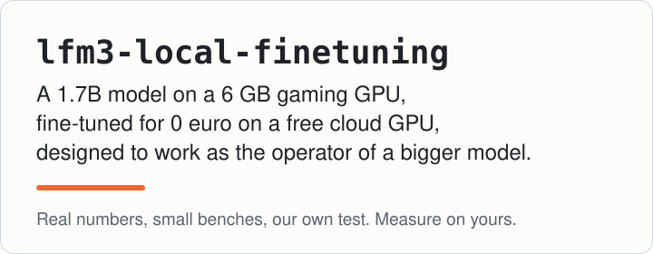
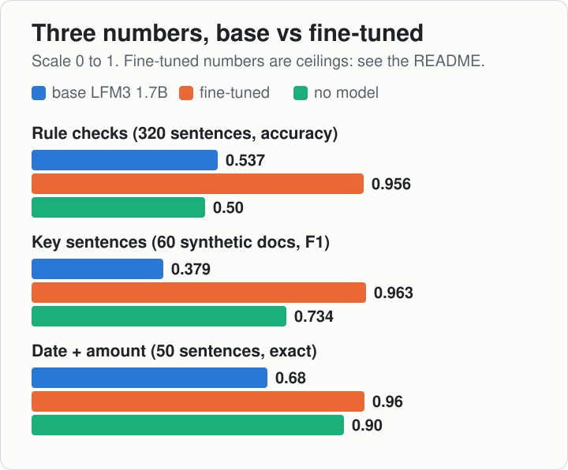
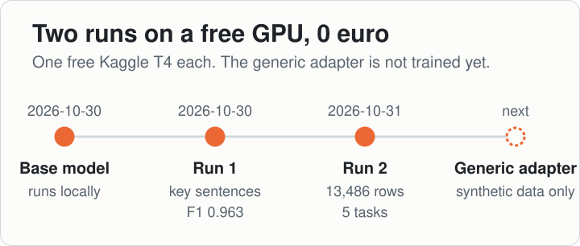
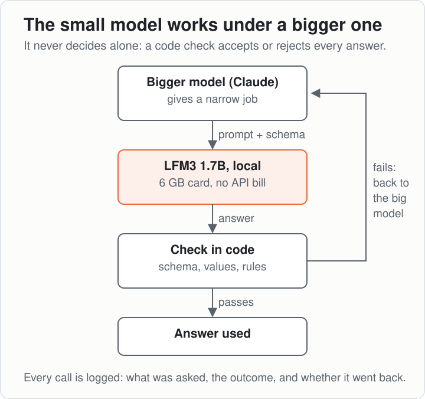
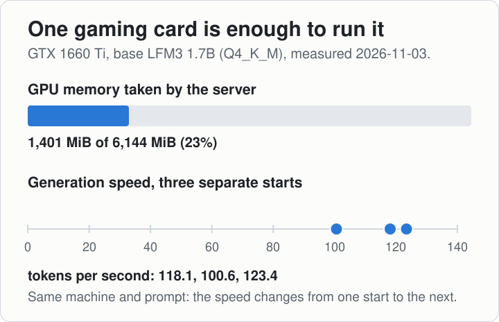
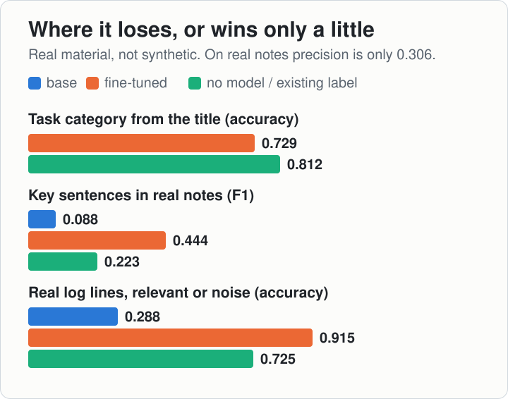
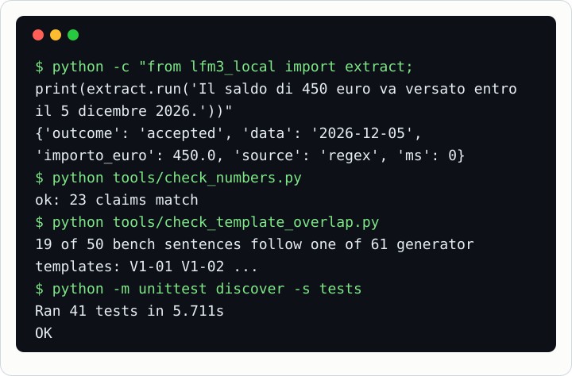

# lfm3-local-finetuning

<p align="center"></p>

**Un modello da 1,7 miliardi di parametri su una scheda da gioco da 6 GB, addestrato a 0 euro su una GPU cloud gratuita, progettato per lavorare come operatore di un modello più grande.**

English: [README.md](README.md). La documentazione in `docs/` è in inglese.

> **Leggi prima questo.** È una nostra esperienza: un progetto che abbiamo fatto in modo simpatico, un nostro test. Non è una base a cui
> riferirsi in modo certo. I numeri sono veri e ognuno viene da un file in [`published_results/`](published_results/), ma sono banchi piccoli,
> costruiti da noi, sul nostro tipo di lavoro. Misura sul tuo prima di fidarti.

## Tre numeri

| Che cosa deve fare il modello | LFM3 1.7B di base | Dopo il nostro addestramento | Senza modello |
|---|---|---|---|
| Dire se una frase viola un insieme di regole di scrittura (4 insiemi, 320 frasi) | 0,537 | **0,956** (giro 2) | 0,50 (sempre la stessa risposta) |
| Scegliere le frasi chiave di un testo (60 documenti sintetici, F1) | 0,379 | **0,963** (giro 1) | 0,734 (lista di parole chiave) |
| Estrarre data e importo da una frase (50 frasi, risposta esatta) | 0,68 | **0,96** (giro 2) | 0,90 (espressioni regolari) |

<p align="center"></p>

Come leggerla:
- **I pesi addestrati non sono pubblici** (vedi sotto): ogni numero si controlla nel suo file, ma la colonna centrale non si può rifare.
- **Quantizzazione diversa:** il modello di base è Q4_K_M, quelli addestrati Q8_0. Una parte di ogni differenza può venire da qui, non dall'addestramento.
- **Frasi chiave:** 0,379 è il modello di base alla soglia 0,5, quella fissata prima per il modello addestrato. Alla sua soglia migliore (0,2)
  il modello di base arriva a 0,534, comunque sotto la lista di parole chiave. I 60 documenti di prova vengono dallo stesso generatore dei dati
  di addestramento: 0,963 è un tetto.
- **Regole di scrittura:** le frasi di prova e quelle di addestramento le ha scritte un modello più grande dalle stesse regole (tolti i quasi
  doppioni): anche questo è un tetto.
- **Estrazione:** 0,68 è il modello di base da solo. Con le espressioni regolari davanti e il controllo, come fa il codice qui, il modello di base
  accetta 47 frasi su 50 e le azzecca tutte e 47. 19 delle 50 frasi di prova seguono un modello di frase del generatore di addestramento
  (le elenca `python tools/check_template_overlap.py`): per il modello addestrato 0,96 è un tetto, non la prova che generalizza.

Il secondo addestramento ha richiesto circa 3 h 20 min su una T4 gratuita di Kaggle (dal log del notebook, trascritto a mano), con 13.486 righe di addestramento, per 0 euro.

<p align="center"></p>

## Che cosa abbiamo fatto

1. **Farlo girare in locale.** [LFM3 1.7B](https://huggingface.co/LiquidAI/LFM3-1.7B) di Liquid AI su llama.cpp, quantizzato Q4_K_M, su un PC con
   GTX 1660 Ti da 6 GB. Nessuna bolletta di API, e il testo non esce dal computer. → [docs/install.md](docs/install.md)
2. **Misurare prima di credere.** Ogni abilità si confronta con una soluzione senza modello. A volte vince la soluzione senza modello.
   → [docs/evaluation.md](docs/evaluation.md)
3. **Addestrarlo su una GPU gratuita.** LoRA su una T4 di Kaggle (quota gratuita), due giri: il primo solo su dati sintetici, il secondo
   su dati sintetici più frasi dal nostro dataset interno su Obsidian. → [docs/free-gpu.md](docs/free-gpu.md), [docs/finetuning.md](docs/finetuning.md),
   [docs/convert-and-serve.md](docs/convert-and-serve.md)
4. **Progettato per lavorare sotto un orchestratore.** Il modello piccolo non decide mai da solo: un modello più grande (per noi Claude) gli
   dà lavori stretti, un controllo nel codice verifica ogni risposta, e ciò che non passa torna al modello grande. Oggi è collegato col
   modello di base e col primo giro, non ancora in uso per il lavoro vero. → [docs/in-our-stack.md](docs/in-our-stack.md)

<p align="center"></p>

<p align="center"></p>

## Dove perde (l'abbiamo lasciato apposta)

- **Indovinare la categoria di un task dal titolo:** 0,729, sotto l'etichetta che le persone avevano già scritto a mano (0,812).
- **Frasi chiave nelle nostre note vere** (non sintetiche): F1 0,444 contro 0,223 della lista di parole chiave e 0,088 del modello di base
  (qui e sui log il modello di base è misurato coi prompt del giro 2, gli stessi del modello addestrato), ma la precisione è solo 0,306. Trova le righe importanti e se ne porta dietro molte altre.
- **Log:** su 153 righe di log vere ne etichetta bene 0,915, contro 0,725 di «è tutto rumore» e 0,288 del modello di base. Qualche riga importante la perde ancora,
  quindi il modello grande legge sempre anche la fine del log.
- **Il modello di base da solo:** il riassunto in una riga di un testo lungo era accettabile 1 volta su 10, e una riscrittura cambiava il
  senso circa 1 volta su 3 (nostre note di laboratorio, [docs/results.md](docs/results.md)).

<p align="center"></p>

## Rifallo tu

Che cosa puoi rifare da questo repository, e che cosa no:

| | Si rifà da qui? |
|---|---|
| Far girare il modello di base in locale e chiamare le abilità | **Sì**: [docs/install.md](docs/install.md) |
| Il numero dell'estrazione del modello di base, con regex e controllo | **Sì**: `bench/extract_bench.jsonl` e `bench/measure_extract.py` |
| Addestrare sui tuoi dati, convertire, servire, misurare | **Sì, la meccanica**: `training/`, [docs/free-gpu.md](docs/free-gpu.md), [docs/convert-and-serve.md](docs/convert-and-serve.md) |
| Dati sintetici per estrazione e log | **Sì, i generatori** (testi con etichette esatte): `data_synthetic/`. Il file di addestramento (prompt di sistema, campo `task`) lo scrivi tu; il nostro prompt dei log non è pubblicato |
| Qualunque numero dei modelli addestrati | No: i pesi non sono pubblici |
| I numeri delle frasi chiave sui 60 documenti sintetici (0,379, 0,963) | No: quei 60 documenti di prova non sono in questo repository |
| Regole di scrittura, log veri, categorie, note vere | No: i banchi vengono da materiale privato; qui ci sono solo i risultati aggregati |
| Il file di addestramento del giro 2 | No: i prompt dei compiti e una parte dei dati sono privati |

Una strada pubblica completa (generatori → file di addestramento → GPU gratuita → banco) è `training/build_generic.py` + `training/kaggle_notebook.ipynb`.
L'abbiamo percorsa il 2026-11-03: un adattatore generico addestrato solo su dati sintetici nuovi (2.730 righe, 2 epoche, 1.176,8 s su una T4
gratuita). Su un banco sintetico di 649 righe costruito con un altro seme, la corrispondenza esatta forzata passa da **0,016** a **0,996**
sull'estrazione e da **0,2005** a **0,9925** sulle righe di log (baseline: regex **0,884**, «sempre rumore» **0,774**). Il banco viene dagli
stessi generatori dei dati di addestramento, con semi diversi (stessa distribuzione), e 19 delle 50 frasi di estrazione scritte a mano
seguono un modello di frase che usa anche il generatore (`tools/check_template_overlap.py`): mostra che l'adattatore ha imparato questi due
formati, non come va su testi veri. Non abbiamo un numero a parte per le 50 frasi scritte a mano: il giro ha registrato un punteggio per
compito, e i pesi dell'adattatore non sono ancora scaricati. Lo 0,016 del modello di base non vuol dire un modello rotto: la corrispondenza
esatta forzata conta giusta una risposta solo se ogni token della risposta attesa, in questo formato d'uscita esatto, è il più probabile
per il modello, e il modello di base questo formato non l'ha mai visto.

```
# 1. avvia il server (docs/install.md)
llama-server -m LFM3-1.7B-Q4_K_M.gguf -c 16384 -np 2 -ngl 99 --host 127.0.0.1 --port 8018 --cache-ram 0 --chat-template-kwargs '{"enable_thinking": false}'
#    in PowerShell il JSON va scritto diversamente: vedi docs/install.md

# 2. usa un'abilità
export PYTHONPATH=src
python -c "from lfm3_local import extract; print(extract.run('Il saldo di 450 euro va versato entro il 5 dicembre 2026.'))"
#    una data, un importo: risponde la regex, il server non serve       -> 'source': 'regex'
python -c "from lfm3_local import extract; print(extract.run('Acconto di 200 euro oggi e saldo di 650 euro entro il 15 gennaio 2027.'))"
#    due importi: risponde il modello, sotto il controllo                -> 'source': 'model', oppure 'outcome': 'escalate' se il controllo non passa

# 3. misurala contro la soluzione senza modello
python bench/measure_extract.py

# 4. dati sintetici, poi impacchetta train.jsonl e dev.jsonl per il cloud
python data_synthetic/gen_logs.py
python training/pack_for_cloud.py <cartella con train.jsonl e dev.jsonl> <cartella da caricare>

# 5. addestra su una T4 gratuita di Kaggle (docs/free-gpu.md), converti e servi (docs/convert-and-serve.md), misura di nuovo
python -m unittest discover -s tests      # non serve il server
```

Provato su Windows 11 con Python 3.14. Le abilità usano solo la libreria standard; l'addestramento richiede torch, transformers e peft.
In `tools/` ci sono i controlli che lanciamo prima di ogni commit: `check_clean.py` (niente percorsi, segreti o nomi privati),
`check_numbers.py` (ogni numero di questo README coincide col suo file), `check_template_overlap.py` e `publish_results.py`.

<p align="center"></p>

## Che cosa è pubblico e che cosa no

| Pubblico qui | Non pubblico |
|---|---|
| Codice, generatori di dati sintetici, il banco di 50 frasi per l'estrazione, script di addestramento | I due modelli addestrati: il secondo ha visto le nostre note interne |
| Numeri aggregati, con clienti e categorie rinominati (set A-D, cat 1-12) | Le nostre note, i banchi costruiti da esse, i titoli dei task e i log veri |

L'adattatore generico batte il modello di base sul suo banco; i pesi non sono ancora in questo repository e, se li pubblicheremo, avranno la licenza LFM allegata (vedi [NOTICE](NOTICE)).

## Licenze

Il nostro codice è MIT ([LICENSE](LICENSE)). Il modello **non** è nostro e non è incluso: LFM3 è di Liquid AI e ha la sua licenza,
riassunta in [NOTICE](NOTICE). L'uso commerciale di LFM3 e di ciò che ne deriva è concesso solo sotto i 10 milioni di dollari di fatturato
annuo. «LFM» e «Liquid AI» appartengono ai loro titolari; questo è un progetto indipendente, non affiliato a Liquid AI né approvato da Liquid AI.

## Chi l'ha fatto

Siamo [AAgency](https://www.aagency.it), agenzia di marketing e software di Bari: questo è un nostro esperimento.
