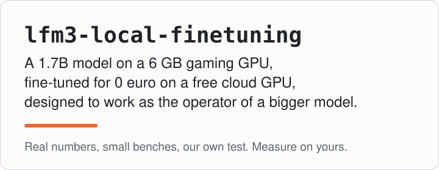
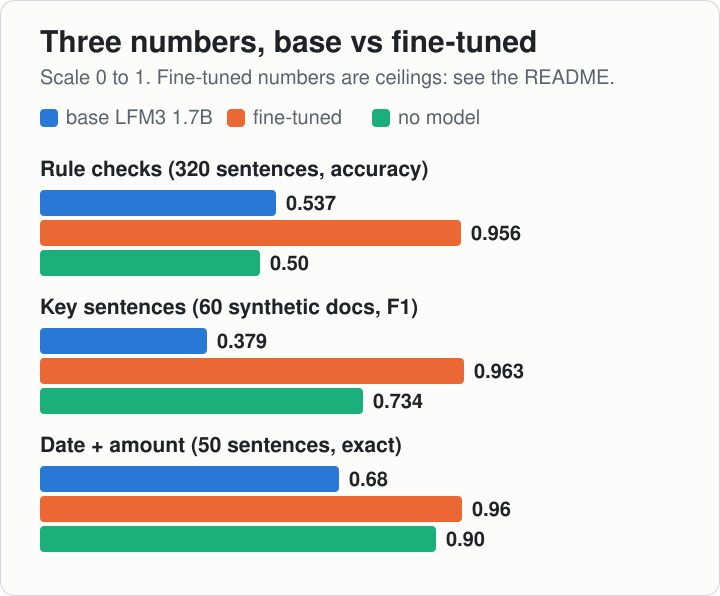
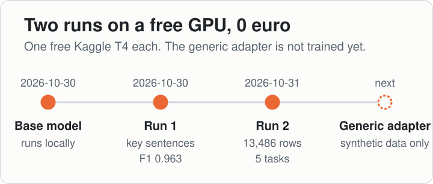
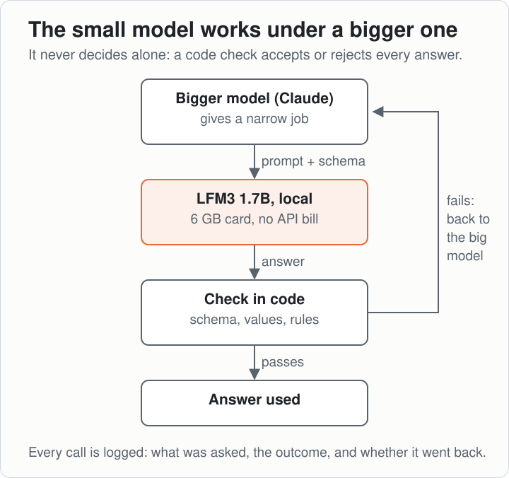
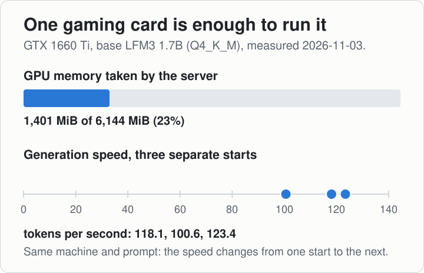
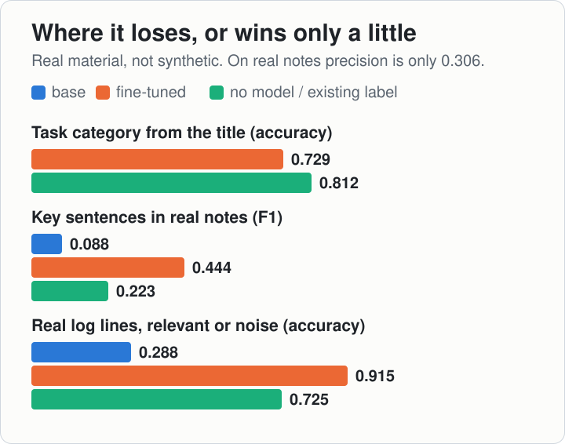
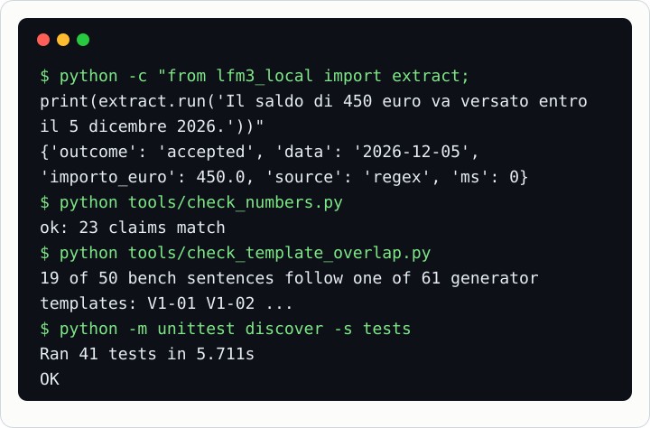

# lfm3-local-finetuning

<p align="center"></p>

**A 1.7B model on a 6 GB gaming GPU, fine-tuned for 0 euro on a free cloud GPU, designed to work as the operator of a bigger model.**

Italiano: [README.it.md](README.it.md)

> **Read this first.** This is our own experience: a project we did for fun, a test of ours. It is not a reference you should rely on
> with certainty. The numbers are real and every one of them comes from a file in [`published_results/`](published_results/), but they are
> small benches, built by us, on our kind of work. Measure on yours before you trust any of it.

## Three numbers

| What the model has to do | Base LFM3 1.7B | After our fine-tuning | Without any model |
|---|---|---|---|
| Say whether a sentence breaks a set of writing rules (4 rule sets, 320 sentences) | 0.537 | **0.956** (run 2) | 0.50 (always the same answer) |
| Pick the key sentences of a text (60 synthetic documents, F1) | 0.379 | **0.963** (run 1) | 0.734 (keyword list) |
| Pull a date and an amount out of a sentence (50 sentences, exact) | 0.68 | **0.96** (run 2) | 0.90 (regular expressions) |

<p align="center"></p>

How to read it:
- **The fine-tuned weights are not public** (see below): you can check every number in its file, but you cannot rerun the middle column.
- **Different quantisation:** the base is Q4_K_M, the fine-tuned models Q8_0. Part of each gap may come from that, not from training.
- **Key sentences:** 0.379 is the base at threshold 0.5, the one fixed in advance for the fine-tuned model. At its own best threshold (0.2)
  the base reaches 0.534, still below the keyword list. The 60 test documents come from the same generator as the training data: 0.963 is a ceiling.
- **Rule sets:** test and training sentences were both written by a larger model from the same rules (near-duplicates removed): a ceiling too.
- **Extraction:** 0.68 is the base model alone. With the regular expressions in front and the validator, as the code here does, the base
  accepts 47 of the 50 and gets all 47 right. 19 of the 50 test sentences follow a sentence template of the training generator
  (`python tools/check_template_overlap.py` lists them), so for the fine-tuned model 0.96 is a ceiling, not proof that it generalises.

The second fine-tuning took about 3 h 20 min on a free Kaggle T4 (from the notebook log, transcribed by hand), with 13,486 training rows, for 0 euro.

<p align="center"></p>

## What we did

1. **Run it locally.** [LFM3 1.7B](https://huggingface.co/LiquidAI/LFM3-1.7B) by Liquid AI on llama.cpp, quantised to Q4_K_M, on a desktop
   GTX 1660 Ti with 6 GB. No API bill, and the text never leaves the machine. → [docs/install.md](docs/install.md)
2. **Measure before believing.** Every skill is scored against a baseline with no model at all. Sometimes the baseline wins.
   → [docs/evaluation.md](docs/evaluation.md)
3. **Fine-tune on a free GPU.** LoRA on a Kaggle T4 (free quota), two runs: the first on synthetic data only, the second on synthetic
   data plus sentences from our internal Obsidian knowledge base. → [docs/free-gpu.md](docs/free-gpu.md), [docs/finetuning.md](docs/finetuning.md),
   [docs/convert-and-serve.md](docs/convert-and-serve.md)
4. **Designed to work under an orchestrator.** The small model never decides alone: a bigger model (Claude, in our case) gives it narrow
   jobs, a code check validates every answer, and anything that fails goes back to the big model. Today this is wired with the base model
   and the first run, not yet used for real work. → [docs/in-our-stack.md](docs/in-our-stack.md)

<p align="center"></p>

<p align="center"></p>

## Where it loses (kept in on purpose)

- **Guessing the category of a task from its title:** 0.729, below the label people had already written by hand (0.812).
- **Key sentences in real internal notes** (not synthetic): F1 0.444 against 0.223 for the keyword list and 0.088 for the base model
  (here and on logs the base was measured with the run-2 prompts, the same as the fine-tuned model), but precision is only 0.306.
  It finds the important lines and drags many others along.
- **Logs:** on 153 real log lines it labels 0.915 correctly, against 0.725 for "everything is noise" and 0.288 for the base model. It still misses some relevant
  lines, so the big model always reads the end of the log as well.
- **The base model on its own:** a one-line summary of a long text was acceptable 1 time in 10, and a rewrite changed the meaning about
  1 time in 3 (our lab notes, [docs/results.md](docs/results.md)).

<p align="center"></p>

## Do it yourself

What you can redo from this repository, and what you cannot:

| | Can you redo it here? |
|---|---|
| Run the base model locally and call the skills | **Yes**: [docs/install.md](docs/install.md) |
| The extraction number of the base, with regex and validator | **Yes**: `bench/extract_bench.jsonl` and `bench/measure_extract.py` |
| Fine-tune on your own data, convert, serve, measure | **Yes, the mechanics**: `training/`, [docs/free-gpu.md](docs/free-gpu.md), [docs/convert-and-serve.md](docs/convert-and-serve.md) |
| Synthetic data for extraction and logs | **Yes, the generators** (texts with exact labels): `data_synthetic/`. The training file (system prompt, `task` field) you write yourself; our log prompt is not published |
| Any number of the fine-tuned models | No: the weights are not public |
| The key-sentence numbers on 60 synthetic documents (0.379, 0.963) | No: those 60 test documents are not in this repository |
| Rule sets, real logs, categories, real notes | No: the benches are built from private material; only aggregate results are here |
| The training file of run 2 | No: its task prompts and part of its data are private |

A complete public path (generators → training file → free GPU → bench) is `training/build_generic.py` + `training/kaggle_notebook.ipynb`.
We ran it on 2026-11-03: a generic adapter trained only on new synthetic data (2,730 rows, 2 epochs, 1,176.8 s on a free T4). On a
synthetic bench of 649 rows built with another seed, forced exact match went from **0.016** to **0.996** on extraction and from **0.2005**
to **0.9925** on log lines (baselines: regex **0.884**, "always noise" **0.774**). The bench comes from the same generators as the
training data, with different seeds (in distribution), and 19 of the 50 hand-written extraction sentences in it follow a template the
generator also uses (`tools/check_template_overlap.py`): it shows the adapter learned these two formats, not how it does on real text.
We have no separate number for the 50 hand-written sentences: the run logged one score per task, and the adapter weights are not
downloaded yet. The base model's 0.016 does not mean a broken model: forced exact match counts an answer as right only if every
token of the expected answer, in this exact output format, is the model's most likely one, and the base model never saw this format.

```
# 1. start the server (docs/install.md)
llama-server -m LFM3-1.7B-Q4_K_M.gguf -c 16384 -np 2 -ngl 99 --host 127.0.0.1 --port 8018 --cache-ram 0 --chat-template-kwargs '{"enable_thinking": false}'
#    PowerShell quotes the JSON differently: see docs/install.md

# 2. use a skill
export PYTHONPATH=src
python -c "from lfm3_local import extract; print(extract.run('Il saldo di 450 euro va versato entro il 5 dicembre 2026.'))"
#    one date, one amount: the regex answers, no server needed  -> 'source': 'regex'
python -c "from lfm3_local import extract; print(extract.run('Acconto di 200 euro oggi e saldo di 650 euro entro il 15 gennaio 2027.'))"
#    two amounts: the model answers under the validator         -> 'source': 'model', or 'outcome': 'escalate' if the check fails

# 3. measure it against the no-model baseline
python bench/measure_extract.py

# 4. synthetic data, then pack your train.jsonl and dev.jsonl for the cloud
python data_synthetic/gen_logs.py
python training/pack_for_cloud.py <folder with train.jsonl and dev.jsonl> <upload folder>

# 5. train on a free Kaggle T4 (docs/free-gpu.md), convert and serve (docs/convert-and-serve.md), measure again
python -m unittest discover -s tests      # no server needed
```

Tested on Windows 11 with Python 3.14. The skills use only the standard library; training needs torch, transformers and peft.
`tools/` holds the checks we run before every commit: `check_clean.py` (no paths, secrets or private names), `check_numbers.py`
(every number in this README matches its file), `check_template_overlap.py` and `publish_results.py`.

<p align="center"></p>

## What is public and what is not

| Public here | Not public |
|---|---|
| Code, synthetic data generators, the 50-sentence extraction bench, training scripts | The two fine-tuned models: the second one saw our internal notes |
| Aggregate numbers, with customers and categories renamed (set A-D, cat 1-12) | Our notes, the benches built from them, real task titles and logs |

The generic adapter beats the base model on its bench; its weights are not in this repository yet and, if we publish them, they will come with the LFM license attached (see [NOTICE](NOTICE)).

## Licenses

Our code is MIT ([LICENSE](LICENSE)). The model is **not** ours and is not included: LFM3 belongs to Liquid AI and has its own license,
summarised in [NOTICE](NOTICE). Commercial use of LFM3 and of anything derived from it is licensed only below 10 million US dollars of
annual revenue. "LFM" and "Liquid AI" belong to their owners; this is an independent project, not affiliated with or endorsed by Liquid AI.

## Who made it

We are [AAgency](https://www.aagency.it), a marketing and software agency in Bari, Italy: this is one of our experiments.
